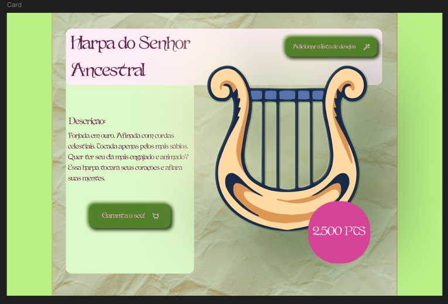
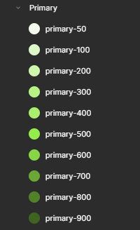
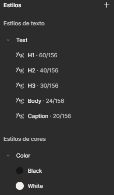

# Entrega – Semana 01: O Diapasão de Orc'estra

**Nome:** Júlia Amanda Silva Lima
**Data:** 26/10/2026

## Link do Figma
(Página "Design System" – "Qualquer pessoa com o link pode ver")
Link: https://www.figma.com/design/KQmdynkym4bb70cwm6EA5g/Orc-estra---J%C3%BAlia-Amanda?node-id=0-1&t=WrRVUXMPSx5wSOuG-1

## Evidências
- 
- 
- 
- 
- 

## Dificuldades
- Tive mais dificuldade relacionadas à criatividade, demorei muito tempo pensando em uma paleta ou nas características do instrumento (nele próprio, nome e descrição).
- Usei um plugin pra criar as paletas, mas tive uns problemas com elas porque as cores não ficaram nomeadas e nem tinham o mesmo hexadecimal das cores que foram pro style. 
- Tive dificuldade também pra mandar para o github, não sabia se era pra criar uma nova branch ou só preencher o "ENTREGA.md" que já estava feito, já que precisava estar em uma pasta com meu nome e etc.
- Ás vezes eu apanhava pro autolayout.

## Perguntas de reflexão
1. O que acontece se você mudar o style `Color/Primary`? Por que isso é útil?
    Todos os elementos com essa cor também seriam modificados e isso é útil pra agilizar o processo, já que em um projeto grande não seria necessária ir em cada componente e mudar sua cor para a nova.
2. Qual é a diferença entre usar a cor pelo style e usar o código hexadecimal solto?
    Padronização, ter somente as cores pelo código hexadecimal pode afetar o design por ir no "feeling", o que não deixa o card profissional/bom.
3. Como o seu Diapasão ajuda a próxima pessoa que for desenhar uma tela nova?
    A próxima pessoa conseguiria seguir o padrão de cores já utilizado sem dificuldade, já que está tudo salvo e nomeado.

## Créditos
- Utilizei esse site para encontrar um fonte de texto que encaixasse no que queria: https://www.dafont.com/pt/theme.php?cat=403
- Utilizei esse site para achar uma paleta de cores: https://color.adobe.com/br/create/color-wheel
- Achei a imagem da Harpa no google.